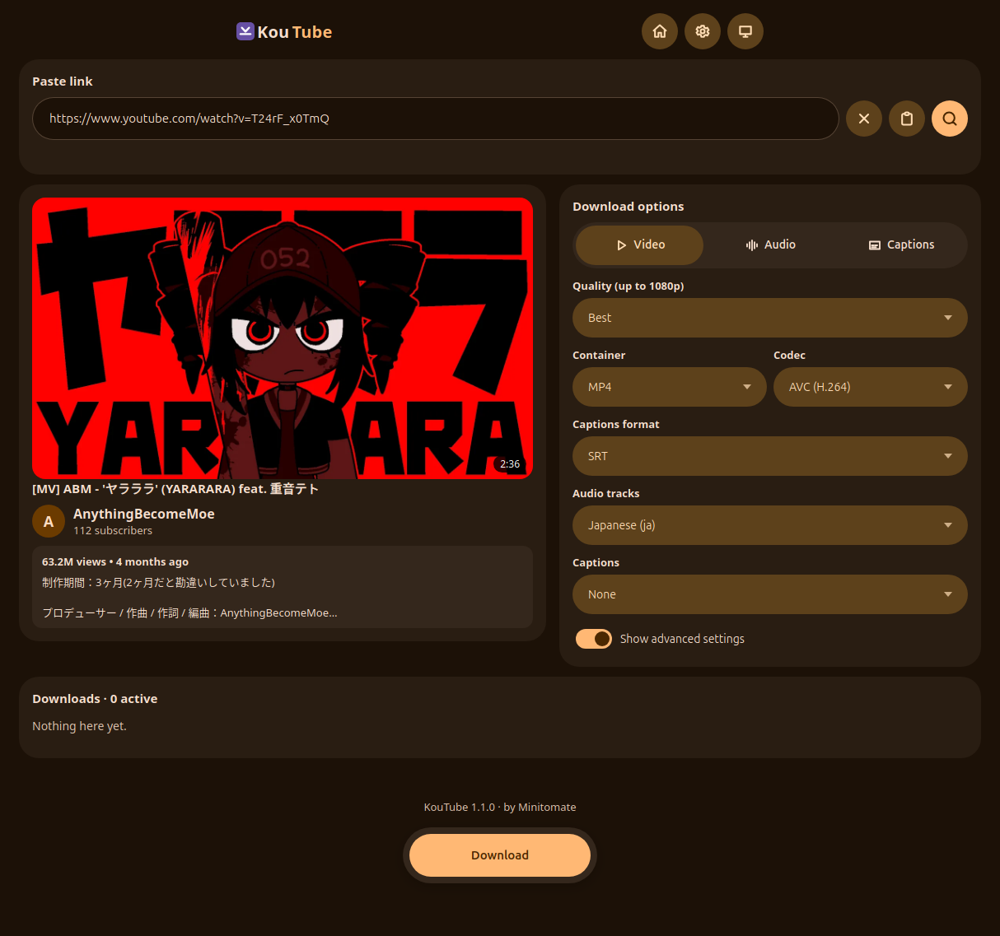
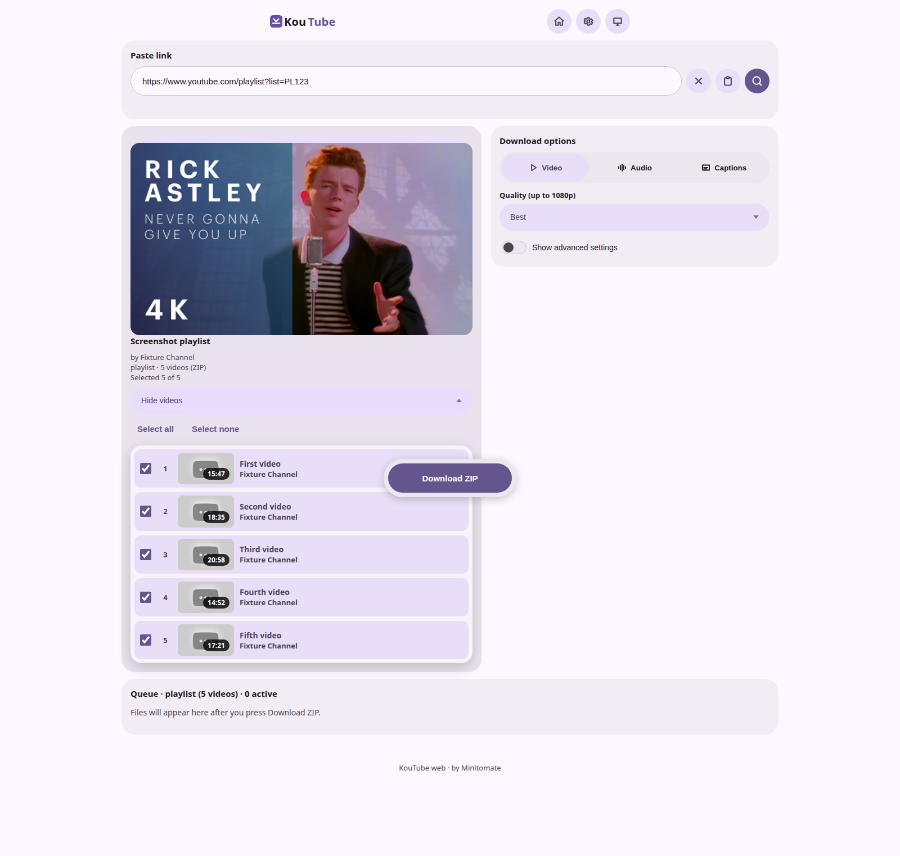
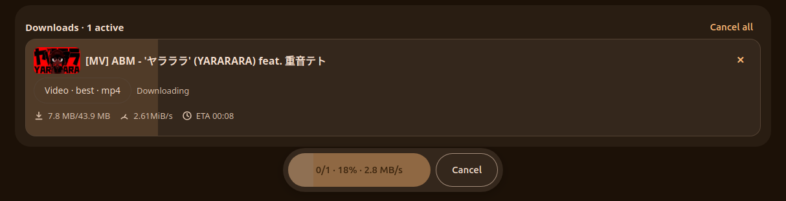
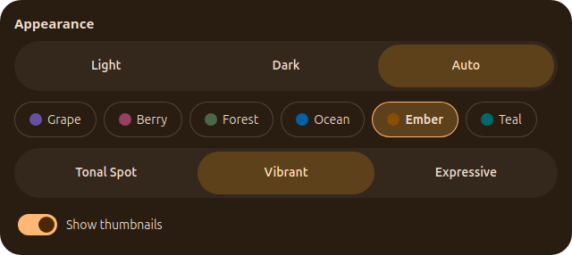

  

<h1 align="center">KouTube</h1>

A local-only YouTube downloader for desktop. Paste a link, pick what you want, save it straight to your disk — no accounts, no servers, no uploads.

## Download

**[KouTube latest release](https://github.com/Minitomate/KouTube/releases/latest)**

Direct downloads:

- **Linux:** [AppImage](https://github.com/Minitomate/KouTube/releases/latest/download/KouTube_1.1.1_amd64.AppImage) (runs anywhere) · [.deb](https://github.com/Minitomate/KouTube/releases/latest/download/KouTube_1.1.1_amd64.deb) · [.rpm](https://github.com/Minitomate/KouTube/releases/latest/download/KouTube-1.1.1-1.x86_64.rpm)
- **Windows:** [installer](https://github.com/Minitomate/KouTube/releases/latest/download/KouTube_1.1.1_x64-setup.exe) · [.msi](https://github.com/Minitomate/KouTube/releases/latest/download/KouTube_1.1.1_x64_en-US.msi)
- **Android 7+ (arm64):** [APK](https://github.com/Minitomate/KouTube/releases/latest/download/KouTube_1.1.1_arm64.apk) — sideload by allowing installs from your browser/file manager. Everything runs on the phone; downloads go to the app's Download folder and play with the system player.

The desktop app checks for updates once a day on launch and can install them in-app (AppImage and Windows installer; `.deb`/`.rpm` point at the releases page instead).

On first launch the app fetches its tools (`yt-dlp` + `ffmpeg`, one-time download) and then works fully offline-capable — everything runs on your machine.

## How it works

1. **Paste** a YouTube link and press Inspect.
2. **Pick** video, audio-only, or captions-only plus quality, container, and languages.
3. **Download** — files land in your folder (desktop) or as a ZIP (web).

The desktop app drives `yt-dlp`/`ffmpeg` locally; the web fallback relays bytes through the bundled backend without storing anything server-side.

## Features

### Inspect any video

Thumbnail, duration, channel, views, and description next to the download options — quality up to 4K, containers MP4/WebM/MKV, codecs AVC/HEVC/VP9/AV1.

### Playlists with per-video picking

Cover art, expandable checklist with durations, select-all default, and batches paced by your Settings concurrency — per-file downloads on desktop, one ZIP on web. Audio mode covers dubs and multi-track picks; captions mode offers manual tracks (SRT/VTT, embedded or sidecar).

### Live download queue

Aggregate floating progress (done/total · % · combined speed), working cancel-all, background-fill cards with lightweight thumbnails, and overwrite confirmation with Play / Show-in-folder actions.

### Settings

Everything tunable in one place:

- Download defaults (format, quality, containers, codecs) applied on every Inspect
- Max concurrent downloads with a stepper
- Light, dark, and auto themes with accent colors and style variants
- English/Spanish UI that follows your system, with manual override
- Thumbnail on/off toggle
- Debug log you can copy or save to a file

### Extras

Offline banner, right-click context menu, update banner.

## Development

Full setup, architecture, tests, and release process live in [DEVELOPMENT.md](./DEVELOPMENT.md).

## Legal

KouTube is for **personal, lawful use**. Download only videos you own or that permit offline use, respect creators' rights, and comply with [YouTube's Terms of Service](https://www.youtube.com/t/terms). Not affiliated with or endorsed by YouTube or Google. Provided as-is under the [MIT License](LICENSE).
